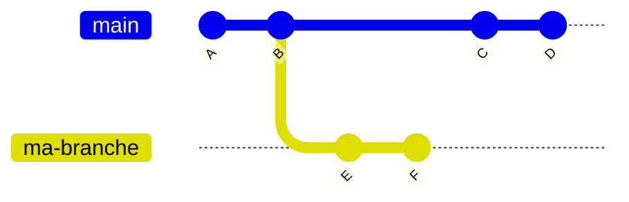
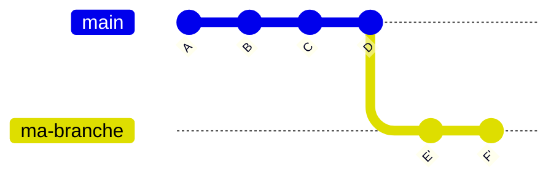

# Contribuer au projet INPS23

## Règles

- `main` est protégée : **seul @matheo.lecompagnon peut y fusionner**.
- Aucun push direct sur `main`.
- Toute modification passe par une **merge request** (MR), qui ne doit contenir qu'un seul sujet.

## Contribuer

**Avec accès au dépôt** : créez une branche (`feat/...`, `fix/...`) et ouvrez une MR vers `main`.

**Sans accès** : forkez le dépôt, travaillez dans votre fork, puis ouvrez une MR vers `main`.

## Avant d'ouvrir une MR

- Une MR = un seul sujet.
- Branche à jour avec `main`.
- Tests et linter OK.
- Description claire (quoi et pourquoi).

## Commits

Format `type: description` (`feat`, `fix`, `docs`, `refactor`, `test`, `chore`).

|Type|Usage|Version |
|:--|:--|:--|
|feat|nouvelle fonctionnalité|MINOR|
|fix|correction de bug|PATCH|
|docs|documentation uniquement|aucun|
|refactor|réécriture sans changer le comportement|aucun|
|test|ajout ou modification de tests|aucun|
|chore|maintenance (dépendances, config, release)|aucun|
|perf|amélioration de performance|PATCH|
|style|mise en forme (espaces, virgules)|aucun|

## Comment faire une MR ?

Supposons que le MR que l'on veut faire concerne la branche `fix/monfix`

### Préparer la branche

La condition à ce qui suit est qu'un seul collaborateur travaille sur une branche donnée. Cela permet d'éviter des problèmes avec le rebase.

`git fetch origin` : récupère le dépôt distant -> origin/main à jour
`git rebase origin/main` : "linéarise" ta branche avec le main :


Après le rebase :


Si tu as un merge conflict :
- Corrige le conflit
- `git add <fichier>`
- `git rebase --continue`
Pour annuler le rebase : `git rebase --abort`
Une fois le rebase terminé
`git push -u origin fix/monfix` si c'est la première fois que tu travailles sur la branche
`git push` sinon

### Ouvrir la MR

1. Ouvre le projet sur gitlab
2. `Code > Merge requests > New Merge request`
3. source = `fix/monfix` et cible = `main`
4. titre, description
5. `Create merge request`

### En cas de commentaires du mainteneur

- Corrige, commit, push : la MR se met à jour automatiquement.

### Une fois la MR validée et fusionnée

Récupères le main et supprime ta branche.
```sh
git checkout main
git pull origin main
git branch -d fix/monfix
```

## Relecture

[@matheo.lecompagnon] relit votre MR, peut demander des modifications, puis la fusionne.

### Maintenance

Protéger le main :
`Settings > Repository > Protected branches`
- `> Allowed to merge` : Maintainers uniquement
- `> Allowed to push` : No one

Si le numéro de la MR est 42 :

```sh
git fetch origin merge-requests/42/head:mr-42
git checkout mr-42
make test
```

Pour fusionner :

`Settings > Merge requests`
- `> Fast-forward merge` : historique, vérifier le rebasement de la branche par le contributeur
- `> Squash commits` : regrouper tous les commits en un
- `> Delete source branch` : a cocher, pour supprimer la branche après fusion

Mise à jour localement
```sh
git checkout main
git pull origin main
```

### Publier des versions

```sh
git checkout main
git pull origin main

# 1. Mettre à jour le CHANGELOG (renommer [Non publié] en [1.1.0] avec la date)
git commit -am "chore: release v1.1.0"

# 2. Créer et pousser le tag
git tag -a v1.1.0 -m "Version 1.1.0"
git push origin main
git push origin v1.1.0
```

Pour créer une release : `Deploy > Releases`